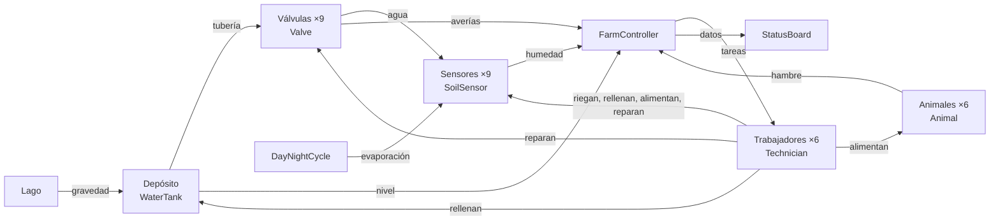
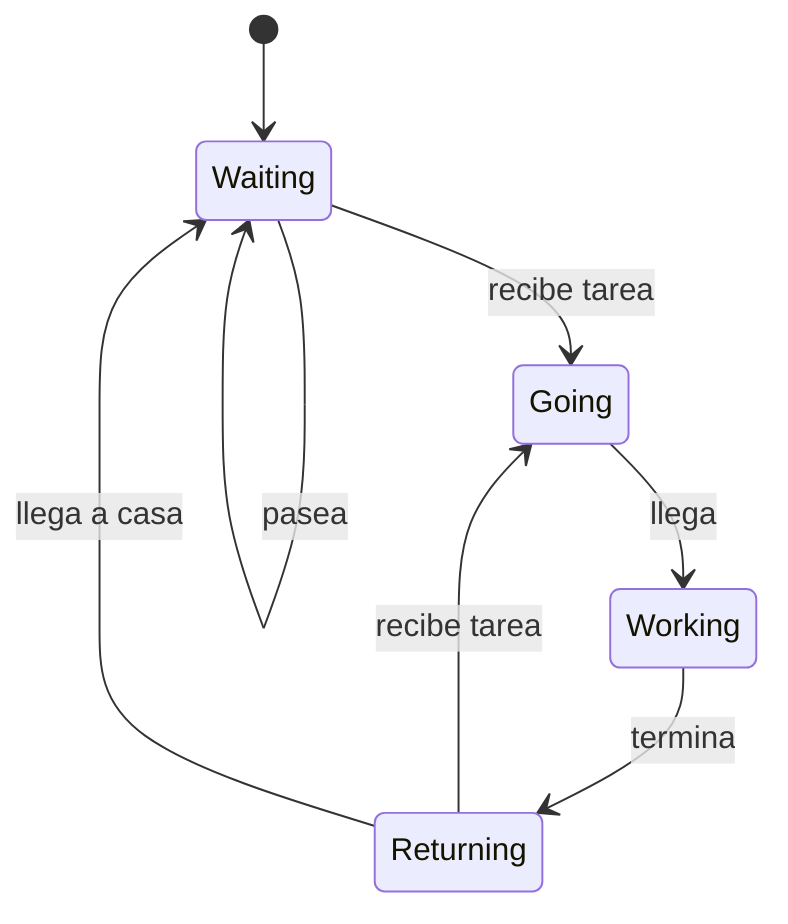

# Smart Farm

Granja inteligente simulada en **Unity**. Se compone de sensores, válvulas, un depósito, animales y trabajadores forman un sistema que se corrige solo y avisa a las personas cuando una máquina no puede resolver el problema. El jugador recorre la granja en primera persona y lee el estado en una pantalla dentro del mundo.

| Dato | Valor |
|---|---|
| Motor | Unity 6000.6.4f1, Universal Render Pipeline 17.6 |
| Escena | `Assets/project.unity` (la única) |
| Terreno | 1000 × 1000 m, tres terrazas |
| Parcelas, sensores y válvulas | 9 de cada |
| Animales y trabajadores | 6 de cada |
| Scripts | 19 en `Assets/_MisCosas/Scripts/` (unas 1070 líneas) |
| Jugadores | Un jugador |

Documentación ampliada: [docs/SmartFarm_Documentation.md](docs/SmartFarm_Documentation.md). Presentación: [docs/Smart Farm - Presentación.pptx](<docs/Smart Farm - Presentación.pptx>) ([PDF](<docs/Smart Farm - Presentación.pdf>)).

## Índice

1. [Cómo funciona](#cómo-funciona)
2. [Puesta en marcha](#puesta-en-marcha)
3. [Estructura del proyecto](#estructura-del-proyecto)
4. [Scripts](#scripts)
5. [Sistema del agua](#sistema-del-agua)
6. [Controlador y reparto de tareas](#controlador-y-reparto-de-tareas)
7. [Trabajadores](#trabajadores)
8. [Animales y ciclo de día y noche](#animales-y-ciclo-de-día-y-noche)
9. [Navegación](#navegación)
10. [Panel de estado](#panel-de-estado)
11. [Build y rendimiento](#build-y-rendimiento)
12. [Decisiones de diseño y límites](#decisiones-de-diseño-y-límites)
13. [Créditos](#créditos)

## Cómo funciona



El sistema automático se ocupa de lo normal y las personas de lo que falla:

| Situación | Respuesta |
|---|---|
| Una parcela se seca | Su válvula se abre sola por debajo de 30 % de humedad y se cierra por encima de 70 % |
| El depósito baja de 20 % | Se crea una tarea y un trabajador lo rellena |
| Una válvula se rompe | Se cierra y espera a que un trabajador la repare |
| Una parcela baja de 5 % | Un trabajador la riega a mano, aunque su válvula esté abierta |
| Un animal tiene hambre | Un trabajador le da de comer |

Los cinco elementos que lo sostienen:

1. Un **modelo del agua** coherente: sensores, válvulas con caudal por gravedad y un depósito que se gasta.
2. Un **controlador central** que convierte problemas en tareas y las reparte con un criterio claro.
3. **Trabajadores con rasgos propios**, guardados en un `ScriptableObject`, que cambian cómo de bien y de rápido hacen cada tarea.
4. Un **mundo vivo**: animales que pasean y tienen hambre, día y noche con luz y niebla, trabajadores que pasean cuando no tienen tarea.
5. Una **pantalla dentro del mundo** que solo lee los datos.

## Puesta en marcha

### Requisitos

- **Unity 6000.6.4f1** (instalar desde Unity Hub).
- **Git LFS**, porque modelos, texturas y otros binarios (unos 370 archivos) están en LFS.

### Abrir el proyecto

```bash
git lfs install
git clone https://github.com/JorgeCarrascoF/SmartFarm.git
```

1. Abrir la carpeta con Unity 6000.6.4f1 desde Unity Hub. La primera apertura tarda, porque Unity regenera `Library`.
2. Abrir `Assets/project.unity`.
3. Pulsar **Play**.

Si faltan texturas o modelos, LFS no estaba instalado al clonar. Ejecuta `git lfs pull`.

### Controles

El jugador usa el controlador en primera persona de Starter Assets: **WASD** para moverse, **ratón** para mirar, **Mayús** para correr y **Espacio** para saltar. Acércate a la pantalla de estado para leerla.

### Qué esperar al jugar

- Las parcelas se secan a ritmos distintos y las válvulas las riegan solas.
- El depósito baja y un trabajador corre a rellenarlo.
- De vez en cuando una válvula se rompe (1 % por segundo mientras fluye agua, así que puede tardar) y alguien la repara.
- Un día dura 4 minutos reales: anochece, aparece la luna y sube la niebla.
- Lo que depende del azar (qué parcela se seca antes, cuándo se rompe una válvula) cambia en cada partida.

## Estructura del proyecto

```text
SmartFarm/
├── Assets/
│   ├── project.unity                 ← la única escena
│   ├── _MisCosas/                    ← todo lo propio
│   │   ├── Scripts/                  ← 19 scripts de C#
│   │   ├── Prefabs/                  ← Valve, filas y columnas del panel, árboles, terrazas...
│   │   ├── Characters/               ← Remy, AvatarDatabase, Character.controller
│   │   ├── Materials/                ← LakeWater
│   │   ├── Layers/                   ← capas de pintura del terreno
│   │   ├── Sprites/                  ← iconos del panel
│   │   ├── Brushes/                  ← pinceles del terreno
│   │   ├── ScreenDark.mat            ← material de la pantalla de estado
│   │   └── New Terrain.asset         ← datos del terreno
│   ├── Pandazole_Ultimate_Pack/      ← edificios y props de granja
│   ├── UrsaAnimation/                ← cabras y ovejas
│   ├── YughuesFreeGroundMaterials/   ← materiales de suelo
│   ├── LowPolyVehicleStarterPack/    ← vehículos
│   ├── Starter Assets/               ← controlador en primera persona
│   ├── TextMesh Pro/                 ← fuentes y shaders del texto
│   ├── Settings/                     ← URP, Volume y perfiles de compilación
│   └── project/                      ← datos del NavMesh
├── Packages/                         ← manifest.json y lockfile
├── ProjectSettings/                  ← ajustes del proyecto
└── docs/                             ← documentación y presentación
```

`_MisCosas` separa lo propio de lo importado. `Library`, `Temp`, `Logs`, `UserSettings` y los archivos de solución se regeneran y están en `.gitignore`.

Paquetes de Unity que usa el proyecto:

| Paquete | Para qué |
|---|---|
| Universal Render Pipeline 17.6 | Renderizado |
| AI Navigation 2.0 | NavMesh para personas y animales |
| Cinemachine | Cámara en primera persona |
| Input System | Entrada del jugador |
| Terrain Tools | Pinceles y herramientas del terreno |
| uGUI | Canvas de la pantalla de estado |

## Scripts

| GameObject | Script(s) | Qué hace |
|---|---|---|
| `Sensors` ×9 | `SoilSensor` | Mide la humedad |
| `Valves` ×9 | `Valve` | Riega y puede romperse |
| Depósito | `WaterTank` | Guarda el agua |
| `FarmController` | `FarmController`, `Job` | Crea y reparte las tareas |
| Trabajadores ×6 | `Technician`, `CharacterAnimation` | Hacen las tareas y se animan |
| `AvatarSpawner` | `AvatarSpawner`, `AvatarDatabase` | Crea a los trabajadores |
| `Animals` ×6 | `Animal` | Pasean y tienen hambre |
| `DayNight` | `DayNightCycle` | Sol, luna, niebla y evaporación |
| `StatusBoard` | `StatusBoard`, `ColumnTerraces`, `ColumnAnimals`, `ColumnWorkers`, `PlotRow`, `AnimalRow`, `WorkerRow` | Muestra el estado |
| Objeto del controlador | `Dashboard` | Primera versión del panel, con `OnGUI` |

Los campos públicos se ajustan desde el Inspector. Los valores de esta documentación son los que trae la escena.

## Sistema del agua

### Sensor de suelo (`SoilSensor`)

La humedad va de 0 a 100 (empieza en 60). Cada segundo pierde `dryRate × dryness × evaporation`:

| Parámetro | Valor | Significado |
|---|---|---|
| `dryRate` | 1,5 | Humedad que pierde por segundo |
| `dryness` | 0,5 a 1,5 (aleatorio) | Cada parcela se seca a su ritmo |
| `evaporation` | 0,4 a 1,5 | Lo fija `DayNightCycle` cada fotograma |

### Válvula (`Valve`)

- Se abre por debajo de **30** de humedad y se cierra por encima de **70**. Entre medias mantiene su estado, para que no parpadee (histéresis).
- Abierta, y con depósito y sin avería, cada fotograma suma `waterPerSecond × caudal` (6) al sensor, resta `tankCostPerSecond × caudal` (0,5) al depósito y puede romperse con probabilidad 0,01 por segundo.
- Rota, no deja pasar agua, no gasta depósito y no se abre sola. Espera a que un trabajador llame a `Repair()`.
- El modelo cambia de color: **verde** abierta, **rojo** cerrada, **naranja** rota.

### Caudal por gravedad

No hay bombas. El lago está a 50 m, la base del depósito a 25,2 m y las terrazas a 14, 11 y 8 m. El desnivel da la presión, y por eso el terreno es de terrazas:

```csharp
float surface = tank.transform.position.y + tankHeight * tank.level / 100f;
float head = Mathf.Max(0f, surface - transform.position.y);
return head / normalHead * pipeFactor;   // normalHead = 15 m, tankHeight = 7 m
```

Consecuencias: las terrazas bajas reciben más agua que las altas y el caudal baja cuando el depósito se vacía (entre un 30 % y un 40 % del lleno al vacío).

| Terraza | Depósito al 100 % | Al 50 % | Al 0 % |
|---|---|---|---|
| Terraza 1 (8 m) | 1,61 | 1,38 | 1,15 |
| Terraza 2 (11 m) | 1,41 | 1,18 | 0,95 |
| Terraza 3 (14 m) | 1,21 | 0,98 | 0,75 |

### Depósito (`WaterTank`)

`level` va de 0 a 100. `Drain` lo vacía (lo usan las válvulas) y `Fill` lo llena (lo usa un trabajador). Además se rellena solo despacio (0,5 por segundo, llega agua del lago) para que la demo no se pare. `Low` es verdadero por debajo de 20 %.

### Reglas

| Regla | Valor |
|---|---|
| Válvula se abre / se cierra | por debajo de 30 / por encima de 70 |
| Gasto del depósito por válvula abierta | 0,5 por segundo con caudal 1 |
| Rotura mientras fluye el agua | 1 % por segundo |
| Depósito bajo | por debajo de 20 % |
| Relleno natural del depósito | 0,5 por segundo |
| Relleno por un trabajador | 60 × factor de Fuerza |

## Controlador y reparto de tareas

`FarmController` es el cerebro. No dibuja nada: cada fotograma actualiza contadores (`tankAlert`, `hungryAnimals`, `brokenValves`), crea o quita tareas (`UpdateJobs`) y las reparte (`AssignJobs`).

| Tarea | Se crea cuando | Efecto al terminar |
|---|---|---|
| `Tank` | Depósito por debajo de 20 % y sin otra tarea de depósito | Añade 60 × Fuerza al depósito |
| `Plot` | Parcela por debajo de 5 % de humedad | Añade 30 × Riego a la parcela |
| `Feed` | Animal con hambre por encima de 60 | Hambre a 0 |
| `Repair` | Válvula rota | La válvula se repara |

**Prioridad** (menor número, antes): depósito (−10), parcela urgente (−8 + humedad / 100), animal con hambre (−5 − hambre / 100) y válvula rota (humedad de su parcela). Orden resultante: depósito, parcela por debajo de 5 %, animal más hambriento, válvula rota con la parcela más seca.

**Elección del trabajador.** Para cada tarea se puntúa a los trabajadores libres:

```text
puntuación = estadística / (1 + distancia / 100)
```

La estadística es Fuerza para el depósito, Manejo de animales para un animal y Riego para parcelas y válvulas. Cada 100 m reducen la puntuación a la mitad, así que un trabajador algo peor pero más cercano puede ganar al mejor que está lejos.

**Reglas del reparto**

- Una tarea, un trabajador. Nadie más puede cogerla.
- Solo se asigna a trabajadores libres (esperando o volviendo a casa). Uno ocupado no se interrumpe.
- Si nadie está libre, la tarea espera al fotograma siguiente.
- Un animal con trabajador asignado se queda quieto (`held`).
- Si no hay NavMesh cerca del punto (30 m para el depósito, 15 m para el resto), la tarea se marca `unreachable` y se avisa en consola.
- Una tarea sin trabajador se elimina cuando ya no hace falta. Si un trabajador desaparece, su tarea queda libre.

## Trabajadores

`AvatarSpawner` lee `AvatarDatabase` y crea a cada trabajador en un círculo de 4 m, le da nombre y estadísticas y lo registra en el controlador.

`AvatarDatabase` es un `ScriptableObject` (`Assets/_MisCosas/Characters/AvatarDatabase.asset`) que se edita en el Inspector. Cada fila tiene `avatarName`, `prefab`, y `speed`, `strength`, `irrigation` y `animalHandling` de 1 a 10 (5 es normal, 1 es 0,6 veces tan bueno, 10 es 1,5). El menú contextual **Generate random records** genera filas una sola vez y las guarda, para que las mismas personas aparezcan siempre.

| Estadística | Qué cambia |
|---|---|
| Velocidad | Velocidad de caminar (3) y de correr (8) |
| Fuerza | Agua que añade al depósito (60) y tiempo en el depósito |
| Riego | Humedad que da a una parcela (30) y tiempo regando o reparando |
| Animales | Tiempo que tarda en alimentar |

El tiempo de trabajo es `4 s / factor`.



Sin tarea, un trabajador se queda quieto entre 3 y 8 s y pasea a un punto del NavMesh a 15 m como máximo de donde está. Una tarea nueva interrumpe el paseo. `Waiting` y `Returning` cuentan como libre.

## Animales y ciclo de día y noche

**Animales.** Hay seis, entre cabras y ovejas, cada uno con `Animal`, `NavMeshAgent` (tipo **Animals**) y `Animator`.

- Pasean: se quedan quietos de 2 a 8 s y caminan a un punto a 30 m como máximo de donde empezaron.
- El hambre sube 0,6 por segundo, multiplicado por un factor aleatorio entre 0,5 y 1,5. Empiezan con hambre aleatoria entre 0 y 42.
- Por encima de **60** están hambrientos y se crea una tarea `Feed`. `Feed()` pone el hambre a 0.

**Día y noche (`DayNightCycle`).** Usa las luces `Sun` y `Moon` y un material de cielo.

| Parámetro | Valor |
|---|---|
| `dayLength` | 240 s por día |
| `hour` inicial | 9 |
| `dayEvaporation` / `nightEvaporation` | 1,5 / 0,4 |
| `moonStrength` | 0,25 de la intensidad del sol |
| `fogDensity` | 0,0012 (niebla exponencial) |

El sol sale a las 6:00, está en lo alto a las 12:00 y se pone a las 18:00. Cambian su color, la luz ambiente y la niebla. La evaporación de todos los sensores sigue la hora: de día las parcelas se secan antes, las válvulas trabajan más y el depósito se gasta antes.

## Navegación

Se usa **AI Navigation** con dos mallas independientes, una para personas (`NavMesh_Avatars`, agente Humanoid, para los trabajadores) y otra para animales (agente **Animals**). Como los animales tienen su propia malla, se quedan en su zona y no hacen falta vallas.

## Panel de estado

Pantalla dentro de la granja (cubo `Screen` con material `ScreenDark` y un Canvas en World Space de 3 × 2,5 m). **Solo lee datos.** Muestra el nombre y la hora, el nivel del depósito con una barra, y tres columnas: **Terrazas** (gota de humedad y engranaje de válvula), **Animales** (icono de hambre) y **Trabajadores** (nombre y etiqueta de tarea).

| Elemento | Verde | Amarillo | Rojo | Gris |
|---|---|---|---|---|
| Gota (humedad) | 40 % o más | por debajo de 40 % | por debajo de 15 % | |
| Engranaje (válvula) | abierta | | rota | cerrada |
| Icono de hambre | hasta 40 | por encima de 40 | por encima de 60 | |
| Barra del depósito | cian | | por debajo de 20 % | |

Etiquetas de los trabajadores: `[TANK]` rellena el depósito, `[WATER]` riega, `[FEED]` alimenta, `[FIX]` repara e `[IDLE]` no tiene tarea.

Cómo funciona: en el primer `Update`, `StatusBoard` llama a `Setup` en cada columna. Cada columna borra las filas del Editor y crea una por elemento de la lista del controlador. Cada 0,25 s (`refreshTime`) se refrescan textos y colores. Si se añaden parcelas o animales, el panel crece solo. Los umbrales están en `StatusBoard` (`lowBelow`, `hungerWarning`) y `FarmController` (`alertBelow`).

`Dashboard` es la primera versión del panel, dibujada con `OnGUI`, y se conserva en el proyecto.

## Build y rendimiento

1. Guarda la escena y el proyecto.
2. En *File > Build Profiles*, abre **Scene List** y comprueba que `Assets/project.unity` está en el índice 0. Quita `SampleScene` si aparece: está vacía y la Build saldría vacía.
3. Elige el perfil **Windows** (`Assets/Settings/Build Profiles/Windows.asset`), pulsa **Build** y elige una carpeta vacía **fuera de `Assets`**.
4. Ejecuta el `.exe`.

La primera Build tarda unos minutos. El modo de pantalla es *Fullscreen Window*, que funciona bien al compartir pantalla en Teams. La pantalla completa exclusiva suele salir negra.

Ajustes que ayudan al rendimiento, por orden de coste: V Sync a *Every V Blank*, Render Scale a 0,85, cascadas de sombra de 4 a 2, mapa de sombras de 2048 a 1024, HDR apagado, sombras de la luna apagadas y menos distancia de detalle del terreno. Una alternativa rápida es asignar `Mobile_RPAsset` al nivel de calidad de Windows. Cambia los ajustes de uno en uno y prueba con la Build.

Más detalle en [docs/SmartFarm_Documentation.md](docs/SmartFarm_Documentation.md#12-build-y-rendimiento).

## Decisiones de diseño y límites

| Decisión | Motivo |
|---|---|
| Un único controlador reparte las tareas | Las estadísticas importan y no hay dos trabajadores con la misma tarea |
| No se interrumpe a un trabajador ocupado | Es más simple y más fácil de explicar |
| Las válvulas tienen histéresis (30 y 70) | Para que no parpadeen |
| Caudal por gravedad | Justifica las terrazas y hace que el depósito importe |
| El depósito se rellena solo despacio | Para que la demo nunca se pare del todo |
| El panel solo lee | Separa la lógica de la interfaz |
| `ScriptableObject` para los trabajadores | Se edita en el Inspector |

Se dejaron fuera, a propósito: agricultor y visitante, lluvia, sonido, modos de cámara y material del lago. Mejoras posibles: lluvia, estadísticas que crecen con la experiencia, más tipos de trabajo y de avería, y sonido.

Se usó **Claude Code** como asistente de programación. Las decisiones de diseño, el montaje de la escena en Unity y las pruebas son del autor.

## Créditos

Proyecto de [JorgeCarrascoF](https://github.com/JorgeCarrascoF). Los assets de terceros conservan sus licencias originales:

- Pandazole Ultimate Pack (granja)
- Low Poly Vehicle Starter Pack
- Unity Starter Assets (controlador en primera persona) y personaje Remy
- UrsaAnimation (cabras y ovejas)
- Yughues Free Ground Materials
- TextMesh Pro
