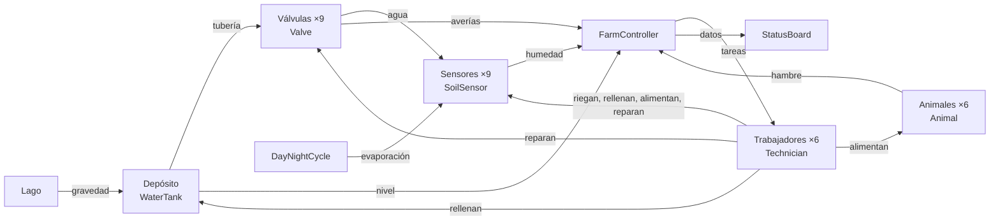
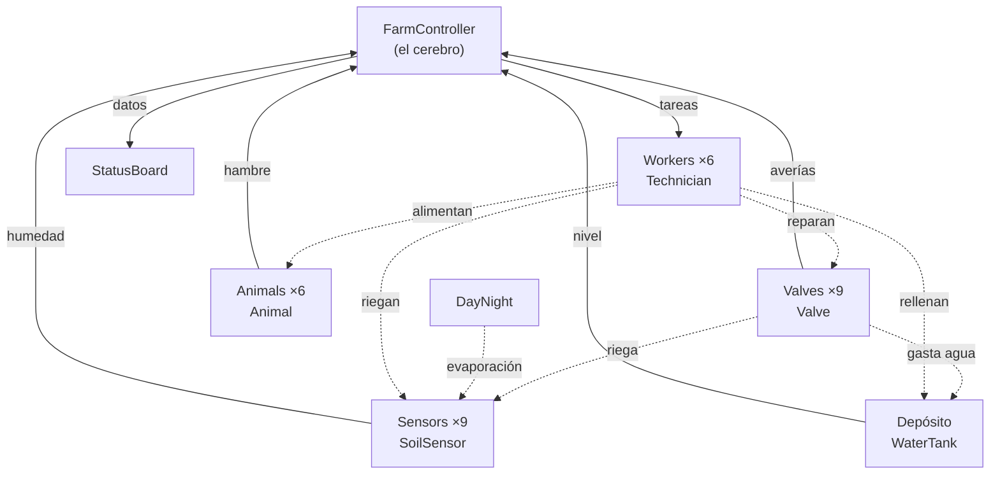
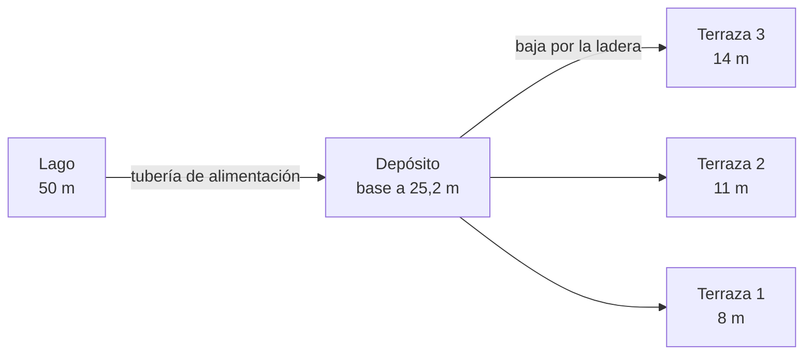
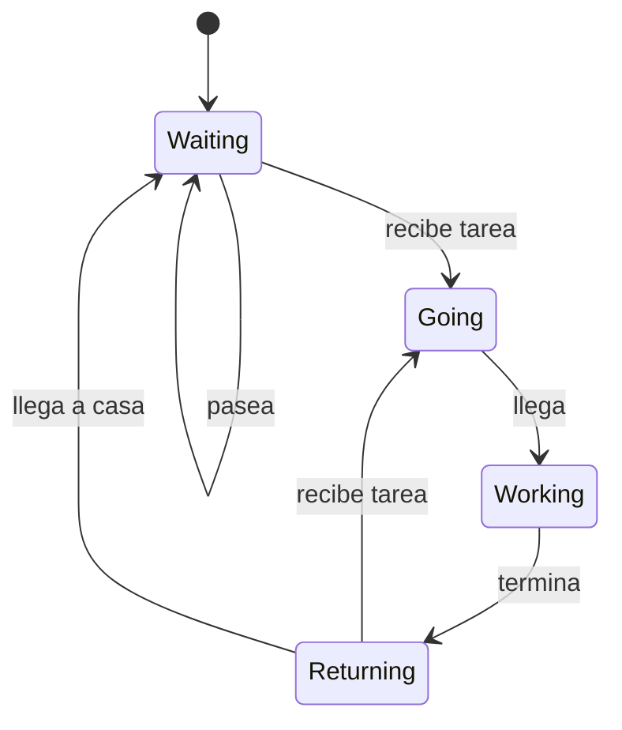

# Smart Farm: documentación

Documentación del proyecto final de CG hecho en Unity: una granja inteligente en la que sensores, válvulas, animales y trabajadores forman un sistema que se corrige solo y llama a personas cuando hace falta.

Este documento amplía todo lo que se explica en la presentación (`Smart Farm - Presentación.pptx`).

| Dato | Valor |
|---|---|
| Motor | Unity 6000.6.4f1, Universal Render Pipeline 17.6 |
| Escena | `Assets/project.unity` |
| Repositorio | https://github.com/JorgeCarrascoF/SmartFarm (con Git LFS) |
| Terreno | 1000 × 1000 m con tres terrazas |
| Parcelas, sensores y válvulas | 9 de cada |
| Animales y trabajadores | 6 de cada |
| Scripts propios | 19, unas 1070 líneas |

## Índice

- [01. Visión general](#01-visión-general)
- [02. Estructura del proyecto](#02-estructura-del-proyecto)
- [03. GameObjects principales](#03-gameobjects-principales)
- [04. Scripts](#04-scripts)
- [05. Assets y materiales](#05-assets-y-materiales)
- [06. Sistema del agua](#06-sistema-del-agua)
- [07. Controlador y tareas](#07-controlador-y-tareas)
- [08. Trabajadores](#08-trabajadores)
- [09. Animales y día/noche](#09-animales-y-díanoche)
- [10. Navegación](#10-navegación)
- [11. Panel de estado](#11-panel-de-estado)
- [12. Build y rendimiento](#12-build-y-rendimiento)
- [13. IA, decisiones y futuro](#13-ia-decisiones-y-futuro)

## El sistema en un dibujo



---

## 01. Visión general

### La idea

Un **gemelo digital** de una granja: el propio mundo explica su estado. El agua es limitada, las parcelas se secan a ritmos distintos y hay cosas que una válvula automática no puede resolver. El proyecto simula cómo una granja así se vigila y se gestiona:

- Los **sensores** miden la humedad de cada parcela.
- Las **válvulas** riegan solas cuando una parcela está seca.
- El **depósito** guarda el agua que llega del lago por gravedad.
- Un **controlador** (`FarmController`) ve todo lo que ocurre y crea tareas.
- Los **trabajadores**, cada uno con sus estadísticas, hacen las tareas que no se pueden automatizar: rellenar el depósito, regar una parcela a punto de morir, reparar una válvula rota y dar de comer a un animal.
- Una **pantalla dentro del mundo** muestra el estado completo.

Es un proyecto de un solo jugador, sin multijugador ni servicios externos. El jugador recorre la granja en primera persona.

### El problema que se resuelve

| Situación | Qué hace el sistema |
|---|---|
| Una parcela se seca | Su válvula se abre sola por debajo de 30 % de humedad y se cierra por encima de 70 % |
| Se gasta el agua del depósito | Por debajo de 20 % se crea una tarea y un trabajador lo rellena |
| Una válvula se rompe | Se cierra y espera a que un trabajador la repare |
| Una parcela llega casi a cero | Un trabajador la riega a mano, aunque su válvula esté abierta |
| Un animal tiene hambre | Un trabajador va a darle de comer |

El resultado es un sistema que se corrige solo hasta que algo necesita a una persona. Eso es lo que da sentido a los trabajadores, a sus estadísticas y al reparto de tareas.

### Por qué el relieve es de terrazas

El agua funciona por gravedad: no hay bombas. El lago está a 50 m, la base del depósito a 25,2 m y las tres terrazas a 14, 11 y 8 m. El desnivel entre el depósito y cada terraza da la presión, y por eso el terreno tiene escalones. Los detalles de la fórmula están en [06. Sistema del agua](#06-sistema-del-agua).

### Los cinco elementos que lo hacen funcionar

1. **Un modelo del agua** coherente: sensores, válvulas con caudal por gravedad y un depósito que se gasta.
2. **Un controlador central** que convierte problemas en tareas y las reparte con un criterio claro.
3. **Trabajadores con rasgos propios**, guardados en una base de datos (`ScriptableObject`), que cambian cómo de bien y de rápido hacen cada tarea.
4. **Un mundo vivo**: animales que pasean y tienen hambre, día y noche con cambios de luz y niebla, trabajadores que pasean si no tienen nada que hacer.
5. **Una interfaz dentro del mundo**: la pantalla de estado, que solo lee los datos.

### Qué queda fuera

Se dejaron fuera, a propósito, el agricultor y el visitante, la lluvia, el sonido, los modos de cámara y el material del lago. Los motivos están en [13. IA, decisiones y futuro](#13-ia-decisiones-y-futuro).

---

## 02. Estructura del proyecto

### Árbol de carpetas

```text
SmartFarm/
├── Assets/
│   ├── project.unity                 ← la única escena
│   ├── _MisCosas/                    ← todo lo propio
│   │   ├── Scripts/                  ← 19 scripts de C#
│   │   ├── Prefabs/                  ← Valve, filas y columnas del panel, árboles, terrazas...
│   │   ├── Characters/               ← Remy, AvatarDatabase, Character.controller
│   │   ├── Materials/                ← LakeWater
│   │   ├── Layers/                   ← capas de pintura del terreno
│   │   ├── Sprites/                  ← iconos del panel
│   │   ├── Brushes/                  ← pinceles del terreno
│   │   ├── ScreenDark.mat            ← material de la pantalla de estado
│   │   └── New Terrain.asset         ← datos del terreno
│   ├── Pandazole_Ultimate_Pack/      ← edificios y props de granja
│   ├── UrsaAnimation/                ← cabras y ovejas
│   ├── YughuesFreeGroundMaterials/   ← materiales de suelo
│   ├── LowPolyVehicleStarterPack/    ← vehículos
│   ├── Starter Assets/               ← controlador en primera persona
│   ├── TextMesh Pro/                 ← fuentes y shaders del texto
│   ├── Settings/                     ← URP, Volume y perfiles de compilación
│   └── project/                      ← datos del NavMesh
├── Packages/                         ← manifest.json y lockfile
├── ProjectSettings/                  ← ajustes del proyecto
└── docs/                             ← esta documentación
```

La carpeta `_MisCosas` separa lo propio de lo importado. Así se sabe siempre qué se ha hecho en el proyecto y qué viene de packs.

### La escena

Hay una sola escena, `Assets/project.unity`, con unos 90 GameObjects. Está organizada con objetos vacíos que agrupan a otros (`Sensors`, `Valves`, `Decorations`, `Vehicles`...) para que la jerarquía sea legible. Los objetos con lógica están descritos en [03. GameObjects](#03-gameobjects-principales).

### Paquetes de Unity

| Paquete | Para qué |
|---|---|
| Universal Render Pipeline 17.6 | Renderizado |
| AI Navigation 2.0 | NavMesh para personas y animales |
| Cinemachine | Cámara del controlador en primera persona |
| Input System | Entrada del jugador |
| Terrain Tools | Pinceles y herramientas del terreno |
| uGUI | Canvas y UI de la pantalla de estado |

### Git y archivos grandes

El repositorio usa **Git LFS** para unos 370 archivos binarios (modelos, texturas, etc.). Se versionan los `.meta` de todos los assets, `Assets`, `Packages` (manifest y lockfile) y `ProjectSettings`. Se ignoran las carpetas regenerables: `Library`, `Temp`, `Logs`, `UserSettings` y los archivos de solución.

### Cómo reconstruir el proyecto

1. Instalar **Git LFS** antes de clonar (`git lfs install`).
2. Clonar `https://github.com/JorgeCarrascoF/SmartFarm.git`.
3. Abrir la carpeta con **Unity 6000.6.4f1** desde Unity Hub. La primera apertura tarda, porque Unity regenera `Library`.
4. Abrir `Assets/project.unity` y pulsar Play.

Si faltan texturas o modelos al abrir, lo habitual es que LFS no estuviera instalado al clonar. En ese caso hay que ejecutar `git lfs pull`.

### Convenciones del código

- Los scripts son cortos y sencillos, con una responsabilidad cada uno.
- Los campos públicos se ajustan desde el Inspector y llevan un comentario con su unidad.
- No hay herramientas de Editor en el proyecto: lo que se necesita se hace a mano en Unity.

---

## 03. GameObjects principales

La escena tiene unos 90 objetos, pero solo una parte tiene lógica. Este documento describe los importantes y, sobre todo, **cómo se relacionan**, con el `FarmController` como centro.

### Tabla de objetos

| GameObject | Qué es | Componentes importantes |
|---|---|---|
| `Terrain` | El suelo, las colinas y las terrazas | Terrain, capas de pintura, hierba y árboles |
| `Lake` | El lago al norte | Plano de agua con el material `LakeWater` |
| `Sun` y `Moon` | Las dos luces direccionales | Light |
| `DayNight` | El reloj del mundo | `DayNightCycle` |
| `Terraces` y `TerraceLane_1..3` | Terrazas y caminos entre ellas | Mallas y colisiones |
| `Sensors` → `SoilSensor_1..9` | Un sensor por parcela | `SoilSensor` |
| `Valves` → `Valve` (×9) | Una válvula por parcela | `Valve` (prefab) |
| Depósito | El tanque de agua en la ladera | `WaterTank` |
| Objeto del controlador | El cerebro de la granja | `FarmController` y `Dashboard` |
| `AvatarSpawner` | Crea a los trabajadores | `AvatarSpawner` |
| `Animals` y `AnimalZone` | Los 6 animales | `Animal`, NavMeshAgent |
| Trabajadores (×6) | Personas que hacen las tareas | `Technician`, `CharacterAnimation`, NavMeshAgent |
| `NavMesh_Avatars` y `NavMesh_Animals` | Mallas de navegación | NavMeshSurface |
| `Player` | El jugador | Controlador en primera persona de Starter Assets |
| `StatusBoard` | La pantalla de estado | `StatusBoard`, `Screen` y un Canvas en World Space |
| `Greenhouses`, `Storage`, `CentralStructures`, `Decorations`, `Vehicles` | Edificios y props | Prefabs de los packs |
| `EventSystem` | Entrada para la UI | Lo exige el Canvas |

### El FarmController es el cerebro

`FarmController` es el único objeto que conoce a todos los demás.

- **Tiene referencias** a todos los sensores, a todas las válvulas y al depósito (se asignan en el Inspector).
- **Encuentra a los animales** al empezar (`FindObjectsByType<Animal>`).
- **Los trabajadores se registran en él** cuando empiezan (`Register`).
- **Lee el estado:** la humedad de cada parcela, el nivel del depósito, las válvulas rotas y el hambre de cada animal.
- **Decide:** crea una lista de tareas (`Job`) y calcula a quién se le da cada una.
- **Reparte:** cada tarea se asigna a un único trabajador libre.

Los demás objetos no se hablan entre sí, salvo las válvulas, que conocen a su sensor y al depósito.



Las líneas continuas son datos que el controlador lee o reparte. Las discontinuas son efectos sobre el mundo.

### Relaciones entre los demás objetos

| De | A | Qué ocurre |
|---|---|---|
| `Valve` | su `SoilSensor` | Lee la humedad para abrirse o cerrarse, y le añade agua cuando fluye |
| `Valve` | `WaterTank` | Le resta agua (0,5 por segundo con caudal normal) |
| `DayNightCycle` | todos los `SoilSensor` | Cambia su evaporación a lo largo del día |
| `Technician` | `FarmController` | Se registra al empezar y avisa cuando termina una tarea |
| `Technician` | sensor, depósito, válvula o animal | Aplica el efecto de la tarea al terminar |
| `AvatarSpawner` | `AvatarDatabase` | Crea un trabajador por fila y le aplica sus estadísticas |
| `StatusBoard` | `FarmController` | Lee los datos cuatro veces por segundo y nunca los cambia |

### Objetos de apoyo

- **`DayNight`:** mueve el sol y la luna y cambia la luz, la niebla y la evaporación ([09](#09-animales-y-díanoche)).
- **`Player`:** el controlador en primera persona de Starter Assets, con Cinemachine.
- **`AvatarSpawner`:** crea a los trabajadores al empezar ([08](#08-trabajadores)).
- **`NavMesh_Avatars` y `NavMesh_Animals`:** las mallas de navegación ([10](#10-navegación)).

---

## 04. Scripts

Todos están en `Assets/_MisCosas/Scripts/`. Son 19 archivos y unas 1070 líneas. Aquí se relaciona cada script con su GameObject y se resumen sus parámetros más importantes.

### Resumen

| GameObject | Script(s) | Qué hace |
|---|---|---|
| `Sensors` ×9 | `SoilSensor` | Mide la humedad |
| `Valves` ×9 | `Valve` | Riega y puede romperse |
| Depósito | `WaterTank` | Guarda el agua |
| `FarmController` | `FarmController`, `Job` | Crea y reparte las tareas |
| Trabajadores ×6 | `Technician`, `CharacterAnimation` | Hacen las tareas y se animan |
| `AvatarSpawner` | `AvatarSpawner`, `AvatarDatabase` | Crea a los trabajadores |
| `Animals` ×6 | `Animal` | Pasean y tienen hambre |
| `DayNight` | `DayNightCycle` | Sol, luna, niebla y evaporación |
| `StatusBoard` | `StatusBoard`, `ColumnTerraces`, `ColumnAnimals`, `ColumnWorkers`, `PlotRow`, `AnimalRow`, `WorkerRow` | Muestra el estado |
| Objeto del controlador | `Dashboard` | Primera versión del panel, en pantalla con OnGUI |

### SoilSensor

Humedad de una parcela, de 0 a 100. Baja sola y una válvula le devuelve el agua.

| Parámetro | Valor | Significado |
|---|---|---|
| `moisture` | 60 al empezar | Humedad actual (0 a 100) |
| `dryRate` | 1,5 | Humedad que pierde por segundo |
| `evaporation` | 1 | Multiplicador que cambia `DayNightCycle` |
| `variation` | 0,5 | Cada parcela se seca entre 0,5 y 1,5 veces más rápido |
| `dryness` | aleatorio | El factor de esa parcela, que se elige en `Awake` |

Cada segundo pierde `dryRate × dryness × evaporation`. `AddWater(amount)` suma y recorta a 100.

### WaterTank

| Parámetro | Valor | Significado |
|---|---|---|
| `level` | 100 | Porcentaje de llenado |
| `refillRate` | 0,5 | Se rellena solo este porcentaje por segundo, para que la demo no se pare |
| `lowLevel` | 20 | Por debajo, `Low` es verdadero |

Métodos: `Drain(amount)` lo vacía y `Fill(amount)` lo llena, siempre entre 0 y 100.

### Valve

Se abre cuando su sensor está seco y se cierra cuando está húmedo. Ver el detalle en [06. Sistema del agua](#06-sistema-del-agua).

| Parámetro | Valor |
|---|---|
| `openBelow` / `closeAbove` | 30 / 70 |
| `waterPerSecond` | 6 (humedad por segundo con caudal normal) |
| `tankCostPerSecond` | 0,5 (depósito por segundo con caudal normal) |
| `breakChance` | 0,01 por segundo mientras fluye el agua |
| `normalHead` / `tankHeight` / `pipeFactor` | 15 m / 7 m / 1 |
| Colores | verde abierta, rojo cerrada, naranja rota |

### Job

Describe una tarea: su tipo (`Plot`, `Repair`, `Tank`, `Feed`), el objeto al que se refiere (la parcela, la válvula o el animal), la posición, el trabajador asignado y un indicador `unreachable` por si no hay NavMesh cerca.

### FarmController

Ver [07. Controlador y tareas](#07-controlador-y-tareas).

| Parámetro | Valor | Significado |
|---|---|---|
| `alertBelow` | 15 | Humedad por debajo de la cual el panel marca la parcela como seca |
| `urgentBelow` | 5 | Humedad que ya genera una tarea de riego |
| `distanceWeight` | 100 | Cada 100 m reducen a la mitad la puntuación de un trabajador |

### Technician

El trabajador. Se explica en [08. Trabajadores](#08-trabajadores).

| Parámetro | Valor |
|---|---|
| `workTime` | 4 s antes de aplicar las estadísticas |
| `tankRefill` | 60 (porcentaje que añade al depósito) |
| `waterGiven` | 30 (humedad que añade a una parcela) |
| `walkSpeed` / `runSpeed` | 3 / 8 |
| `wanderRadius` | 15 m |
| `pause` | entre 3 y 8 s |

### CharacterAnimation

Indica al `Animator` la velocidad del agente para que el personaje camine al moverse y esté quieto al parar. Como la granja es grande, el agente se mueve más rápido de lo que preveían las animaciones, y las animaciones se reproducen más rápido en la misma proporción (`speedScale`) para que los pies no resbalen.

### AvatarDatabase y AvatarSpawner

`AvatarDatabase` es un `ScriptableObject` con las filas de los trabajadores. `AvatarSpawner` crea un trabajador por cada fila al empezar. Ver [08. Trabajadores](#08-trabajadores).

### Animal

| Parámetro | Valor |
|---|---|
| `hungerRate` | 0,6 por segundo, con variación de 0,5 entre animales |
| `hungryAbove` | 60 |
| `wanderRadius` | 30 m |
| `speed` | 1,2 |
| `pause` | entre 2 y 8 s |
| `displayName` | nombre opcional que se enseña en el panel |

### DayNightCycle

Ver [09. Animales y día/noche](#09-animales-y-díanoche).

### StatusBoard, columnas y filas

Ver [11. Panel de estado](#11-panel-de-estado).

### Dashboard

Es la primera versión del panel: un recuadro en pantalla dibujado con `OnGUI` que lista cada parcela, el depósito y los trabajadores. Se mantiene como alternativa de depuración y se puede apagar desmarcando el componente.

---

## 05. Assets y materiales

### Packs y personajes

| Asset | Para qué se usa |
|---|---|
| **Pandazole Ultimate Pack** (Farm Ranch Pack) | Edificios, graneros, invernaderos y props |
| **UrsaAnimation** (Low Poly Cubic, Goat and Sheep Pack) | Cabras y ovejas con sus animaciones |
| **YughuesFreeGroundMaterials** (URP) | Texturas y materiales de suelo para las capas del terreno |
| **LowPolyVehicleStarterPack** | Vehículos de decoración |
| **Mixamo: Remy** | El modelo humano de los trabajadores, con Idle, Walking y Running |
| **Starter Assets** (Unity) | Controlador en primera persona y skybox de ejemplo |
| **TextMesh Pro** | Texto nítido en la pantalla de estado |
| Iconos PNG: gota, engranaje y hambre | Símbolos del panel (`Assets/_MisCosas/Sprites`) |

> [!NOTE]
> Falta citar aquí la fuente y la licencia de los packs y de los tres iconos.

El personaje **Ch21** está importado pero no se usa. Se descartó porque no aportaba nada a la simulación.

### Personajes y animación

Los trabajadores usan **Remy** de Mixamo con rig **Humanoid**. Las tres animaciones (Idle, Walking, Running) comparten un único `Animator Controller`, `Assets/_MisCosas/Characters/Character.controller`, que usa el parámetro `Speed`:

- por debajo de 0,1: Idle
- entre 0,1 y 2,75: Walking
- por encima de 2,75: Running

`CharacterAnimation` calcula `Speed` como la velocidad del agente dividida por `speedScale`.

Las cabras y ovejas usan un controlador propio (`Goat&SheepAnimCont`). Se le quitaron las transiciones automáticas de reposo, y el script `Animal` arranca las animaciones `idle` y `walk_forward` por nombre.

### Materiales

| Elemento | Descripción |
|---|---|
| `LakeWater` | Material del agua del lago |
| Materiales de Remy | `Bodymat`, `Topmat`, `Bottommat`, `Hairmat`, `Eyelashmat`, `Shoesmat` |
| `ScreenDark` | Fondo oscuro de la pantalla de estado |
| Skybox | Material de cielo de Starter Assets, asignado en `DayNightCycle` |
| Colores de las válvulas | Se cambian por código: verde abierta, rojo cerrada, naranja rota |
| Shaders | URP Lit en el mundo y TextMeshPro SDF en el texto |

### Capas de pintura del terreno

Seis capas en `Assets/_MisCosas/Layers`:

| Capa | Uso previsto |
|---|---|
| `Grass` | Base de casi todo el terreno |
| `DryGrass` | Hierba más seca, para variar el color |
| `CropSoil` | Tierra de cultivo en las parcelas |
| `Path` | Caminos y la zona de edificios |
| `Rock` | Pendientes pronunciadas |
| `Shore` | Orilla del lago |

### Iconos del panel

Tres PNG blancos con fondo transparente en `Assets/_MisCosas/Sprites`:

- `waterdrop.png`: la humedad de una parcela.
- `gear.png`: el estado de la válvula.
- `hunger.png`: el hambre de un animal.

Son blancos para poder teñirlos con el color del estado desde el código (`Image.color`). `WhiteSquare.png` es un cuadrado blanco para las barras de tipo Filled.

---

## 06. Sistema del agua

Tres componentes forman el sistema: los **sensores** miden, las **válvulas** riegan y el **depósito** guarda el agua. Todo el caudal es por gravedad.

### Recorrido del agua



Cada terraza tiene tres parcelas, y cada parcela tiene su sensor y su válvula. Son 9 sensores y 9 válvulas.

### SoilSensor: la humedad

- La humedad va de 0 (seca del todo) a 100 (empapada).
- Cada segundo pierde `dryRate × dryness × evaporation`: 1,5 por un factor propio de la parcela y por la evaporación del momento.
- `dryness` se elige al azar al empezar, entre 0,5 y 1,5, así las parcelas no se secan todas a la vez.
- `evaporation` la fija `DayNightCycle` cada fotograma: 1,5 al mediodía y 0,4 de noche.

Con esos números, una parcela pierde entre unos 0,3 y unos 3,4 de humedad por segundo según la parcela y la hora.

### Valve: la válvula

#### Abrir y cerrar

Si la válvula no está rota, mira la humedad de su sensor:

- por debajo de **30**, se abre;
- por encima de **70**, se cierra;
- entre medias, **mantiene** su estado.

Esa histéresis evita que parpadee abriendo y cerrando cada fotograma.

#### Qué ocurre mientras está abierta

Si está abierta, no está rota y el depósito no está vacío, cada fotograma:

1. calcula el caudal con `Flow()`;
2. añade `waterPerSecond × caudal` (6 de humedad por segundo con caudal 1) al sensor;
3. quita `tankCostPerSecond × caudal` (0,5 de depósito por segundo con caudal 1) al depósito;
4. puede romperse, con una probabilidad de `breakChance` (0,01) por segundo.

Una válvula abierta aporta bastante más agua (6 por segundo) de la que pierde la parcela, así que la parcela se recupera hasta cerrarse en 70.

#### Averías

Si se rompe, `isBroken` pasa a verdadero y `isOpen` a falso. Una válvula rota:

- no deja pasar agua,
- no gasta agua del depósito,
- no se vuelve a abrir sola,
- espera a que un trabajador llame a `Repair()`.

La parcela sigue secándose, así que acaba pidiendo un riego urgente a mano si nadie repara la válvula.

#### Colores en el mundo

El modelo de la válvula (`indicator`) cambia de color: **verde** abierta, **rojo** cerrada y **naranja** rota.

### Por qué la gravedad importa

El caudal de cada válvula depende del desnivel entre la superficie del agua del depósito y la propia válvula:

```csharp
float surface = tank.transform.position.y + tankHeight * tank.level / 100f;
float head = Mathf.Max(0f, surface - transform.position.y);
return head / normalHead * pipeFactor;
```

- `surface` es la altura de la superficie del agua: la base del depósito más `tankHeight` (7 m) multiplicado por el nivel de llenado.
- `head` es el desnivel hasta la válvula. Una válvula más baja tiene más desnivel.
- El caudal es `head / normalHead`, con `normalHead` en 15 m. Con 15 m de desnivel el caudal es 1.
- `pipeFactor` representa una tubería más estrecha o larga: por debajo de 1 reduce el caudal.

#### Dos consecuencias

1. **Las terrazas bajas reciben más agua que las altas.**
2. **El caudal baja a medida que se vacía el depósito.**

#### Ejemplo numérico

Con las alturas de diseño (base del depósito a 25,2 m, terrazas a 14, 11 y 8 m), las cifras son aproximadas:

| Terraza | Depósito al 100 % | Al 50 % | Al 0 % |
|---|---|---|---|
| Terraza 1 (8 m) | 1,61 | 1,38 | 1,15 |
| Terraza 2 (11 m) | 1,41 | 1,18 | 0,95 |
| Terraza 3 (14 m) | 1,21 | 0,98 | 0,75 |

Del depósito lleno al vacío, el caudal baja entre un 30 y un 40 %. No se corta de golpe: solo se anula cuando el nivel llega a 0. Las posiciones reales en la escena pueden variar unos metros respecto a estas alturas de diseño.

### WaterTank: el depósito

- `level` va de 0 a 100 (porcentaje).
- `Drain` lo vacía, y las válvulas abiertas lo usan.
- `Fill` lo llena, y lo usa el trabajador que lo rellena.
- Se rellena sola despacio (`refillRate` 0,5 por segundo), porque llega agua del lago. Así la demo nunca se queda totalmente parada.
- `Low` es verdadero por debajo de 20 %. Eso crea una tarea para un trabajador.

### Reglas en una tabla

| Regla | Valor |
|---|---|
| Una válvula se abre por debajo de | 30 de humedad |
| Una válvula se cierra por encima de | 70 de humedad |
| Gasto del depósito por válvula abierta | 0,5 por segundo con caudal 1 |
| Rotura mientras fluye el agua | 1 % por segundo |
| Depósito bajo | por debajo de 20 % |
| Relleno natural del depósito | 0,5 por segundo |
| Relleno por un trabajador | 60 × factor de Fuerza |

---

## 07. Controlador y tareas

`FarmController` convierte los problemas de la granja en tareas y las reparte a los trabajadores. Es el cerebro del sistema. Está en `Assets/_MisCosas/Scripts/FarmController.cs`.

### Qué guarda

- `sensors`, `valves` y `tank`: referencias asignadas en el Inspector.
- `animals`: los animales, que encuentra al empezar.
- `workers`: los trabajadores, que se registran solos al empezar.
- `jobs`: la lista de tareas abiertas.
- Tres contadores que lee el panel: `tankAlert`, `hungryAnimals` y `brokenValves`.

### Cada fotograma

1. Actualiza los contadores.
2. `UpdateJobs()`: crea las tareas nuevas y quita las que ya no hacen falta.
3. `AssignJobs()`: ordena las tareas por prioridad y las reparte.

### Las cuatro tareas

| Tarea | Se crea cuando | Efecto al terminar |
|---|---|---|
| `Tank` | El depósito está por debajo de 20 % y no hay otra tarea de depósito | Añade 60 × factor de Fuerza al depósito |
| `Plot` | Una parcela está por debajo de 5 % de humedad | Añade 30 × factor de Riego a la parcela |
| `Feed` | Un animal tiene hambre (por encima de 60) | El animal pasa a hambre 0 |
| `Repair` | Una válvula está rota | La válvula se repara |

Cada tarea guarda a qué objeto se refiere, dónde está y qué trabajador la tiene.

#### Cuándo se quita una tarea

Una tarea sin trabajador asignado se elimina si ya no hace falta. Por ejemplo, si un animal deja de tener hambre porque otro trabajador pasó antes. Las que ya tienen trabajador se mantienen hasta que él las termina.

### Prioridad

Se ordenan de menor a mayor número, y las primeras se reparten antes.

| Tarea | Valor de prioridad | Orden |
|---|---|---|
| Depósito | −10 | Siempre primero |
| Parcela urgente | −8 + humedad / 100 | Antes, la más seca |
| Animal con hambre | −5 − hambre / 100 | Antes, el más hambriento |
| Válvula rota | humedad de su parcela | Antes, la parcela más seca |

El orden resultante es: **depósito, parcela por debajo de 5 %, animal más hambriento, válvula rota con la parcela más seca**.

### Puntuación de un trabajador

Para cada tarea, se mira a todos los trabajadores libres y se calcula:

```text
puntuación = estadística / (1 + distancia / 100)
```

- **Estadística:** el factor que pide la tarea.
  - Depósito: **Fuerza**.
  - Animal: **Manejo de animales**.
  - Parcela y válvula rota: **Riego**.
- **Distancia:** en metros entre el trabajador y la tarea. Cada 100 m reducen la puntuación a la mitad (`distanceWeight`).

Gana el de mayor puntuación. Un trabajador muy bueno puede perder contra otro algo peor pero más cercano. Esto es lo que da sentido a las estadísticas: no son decoración.

### Reglas del reparto

- **Una tarea, un trabajador.** Al asignarla se guarda quién la tiene, y nadie más puede cogerla.
- **Solo trabajadores libres.** Libre es esperando o volviendo a casa. Un trabajador que va a una tarea o está trabajando no se interrumpe.
- **Si nadie está libre,** la tarea espera y se vuelve a intentar al fotograma siguiente.
- **Los animales se paran.** Al asignar una tarea de comer, el animal queda en espera (`held`) para que el trabajador lo encuentre. Se busca su posición actual, porque los animales pasean.
- **Tareas inalcanzables.** Si no hay NavMesh cerca del punto (a menos de 30 m para el depósito o a menos de 15 m para el resto), la tarea se marca `unreachable` y se avisa en la consola. Así no se reintenta en bucle.
- **Si un trabajador desaparece,** la tarea que llevaba vuelve a quedar libre y el animal deja de esperar.

### Ejemplo

El depósito baja de 20 % y hay tres trabajadores libres. Se crea una tarea `Tank`, que es la de mayor prioridad. Se calcula la puntuación de cada trabajador:

| Trabajador | Fuerza | Distancia | Puntuación |
|---|---|---|---|
| A | 1,3 | 200 m | 1,3 / 3 = 0,43 |
| B | 1,0 | 50 m | 1,0 / 1,5 = 0,67 |
| C | 0,8 | 40 m | 0,8 / 1,4 = 0,57 |

B tiene la mayor puntuación y recibe la tarea, aunque A sea el más fuerte, porque está lejos.

### Dashboard y panel

El controlador no dibuja nada. Solo expone datos. Los lee `StatusBoard` ([11](#11-panel-de-estado)) y, en la primera versión, `Dashboard`.

---

## 08. Trabajadores

Los trabajadores son las personas de la granja. Cada uno tiene su propio perfil de estadísticas, que cambia cómo de rápido camina y cómo de bien hace cada tarea.

### Cómo nacen

1. `AvatarSpawner` lee `AvatarDatabase` al empezar.
2. Para cada fila crea una instancia del prefab, en un círculo de 4 m alrededor del spawner. Si hay NavMesh cerca, se pone sobre él.
3. Le da el nombre de la fila (por ejemplo "Marta").
4. Le asigna el `FarmController` y le aplica sus estadísticas con `Apply(record)`.
5. El trabajador se registra en el controlador cuando empieza.

Los seis usan hoy el modelo Remy, pero el diseño permite un prefab distinto por fila.

### La base de datos: AvatarDatabase

Es un `ScriptableObject`, un archivo de datos que vive en el proyecto y se edita en el Inspector: `Assets/_MisCosas/Characters/AvatarDatabase.asset`.

Cada fila (`Record`) tiene:

| Campo | Valores |
|---|---|
| `avatarName` | Nombre de la persona |
| `prefab` | El modelo que se crea |
| `speed`, `strength`, `irrigation`, `animalHandling` | De 1 a 10 |

Un 5 es un trabajador normal (factor 1,0). Un 1 es 0,6 veces tan bueno y un 10 es 1,5 veces. Es una escala lineal.

La base de datos tiene un comando de menú contextual, **Generate random records**. Tira los dados una vez, guarda los resultados y reemplaza todas las filas. Así las mismas personas aparecen siempre que se inicia el juego. Usa `people` (6), `minStat` (2) y `maxStat` (9), y una lista de nombres.

### Qué cambia cada estadística

| Estadística | Qué cambia |
|---|---|
| **Velocidad** | La velocidad de caminar (3) y de correr (8) |
| **Fuerza** | La cantidad que añade al depósito (60) y el tiempo en el depósito |
| **Riego** | La humedad que da a una parcela (30) y el tiempo regando o reparando |
| **Animales** | El tiempo que tarda en alimentar |

El tiempo de trabajo es `4 s / factor`. Con un factor alto, el trabajo se hace antes.

### Estados



| Estado | Qué hace |
|---|---|
| `Waiting` | Espera o pasea. Está libre |
| `Going` | Corre hacia la tarea a velocidad de carrera |
| `Working` | Trabaja durante el tiempo de la tarea |
| `Returning` | Camina a casa. Sigue libre y puede coger otra tarea por el camino |

### Qué hace al terminar una tarea

| Tarea | Efecto |
|---|---|
| Depósito | `tank.Fill(tankRefill)` |
| Animal | `animal.Feed()` |
| Parcela | `plot.AddWater(waterGiven)` |
| Reparación | `valve.Repair()` |

Después avisa al controlador (`Complete`) y vuelve a casa caminando.

### Pasear cuando no hay nada que hacer

Un trabajador sin tarea se queda quieto entre 3 y 8 segundos. Después elige un punto aleatorio a 15 m como máximo de **donde está ahora** (no de su casa), lo busca en el NavMesh con una tolerancia de 3 m y camina hasta allí. Si el punto no está sobre la malla, espera otra pausa. Una nueva tarea interrumpe el paseo.

Como cada paseo parte de donde acabó el anterior, los trabajadores se van repartiendo por la granja. Eso no importa: el controlador elige al más cercano.

### Animación

`CharacterAnimation` pone la velocidad del agente en el parámetro `Speed` del `Animator` y ajusta la velocidad de reproducción. Como el agente va más rápido de lo que preveía el clip, `Apply` fija `speedScale = runSpeed / 4` para que las animaciones y los pies mantengan el ritmo.

### Etiquetas

Para el panel, `Tag` devuelve una palabra por tarea: `[TANK]`, `[FEED]`, `[WATER]`, `[FIX]` o `[IDLE]` (sin tarea, incluida la vuelta a casa). La propiedad `Activity` devuelve un texto más largo y solo la usa el `Dashboard` original.

---

## 09. Animales y día/noche

Los dos dan vida al mundo y tienen efecto en el sistema: los animales generan tareas y el ciclo de luz cambia la evaporación.

### Animales

Hay seis, entre cabras y ovejas. Cada uno tiene `Animal`, un `NavMeshAgent` del tipo **Animals** y un `Animator`.

#### Pasear

- Cada animal se queda quieto entre 2 y 8 segundos.
- Después elige un punto aleatorio a 30 m como máximo del lugar donde empezó (`center`), lo busca en la malla de animales con una tolerancia de 5 m y camina hasta allí a 1,2 de velocidad.
- Al llegar, vuelve a esperar.

Como su malla de navegación es propia, los animales se quedan en su zona y la granja no necesita vallas.

#### Hambre

- El hambre sube a razón de 0,6 por segundo. Cada animal la multiplica por un factor aleatorio entre 0,5 y 1,5.
- Al empezar, cada uno parte de un hambre aleatoria entre 0 y 42 para que no se pongan hambrientos a la vez.
- Por encima de **60** está hambriento (`IsHungry`) y el controlador crea una tarea `Feed`.

#### Esperar a que lo alimenten

Cuando se le asigna un trabajador, el animal se queda quieto (`held`) y reproduce `idle`. Cuando el trabajador termina, `Feed()` pone el hambre a 0 y el animal vuelve a pasear.

#### Animaciones

El controlador de animación de los packs no tiene transiciones automáticas entre reposo y andar. El script arranca `idle` y `walk_forward` por nombre con `CrossFade` (0,25 s) y apaga la animación de raíz, porque el agente es quien mueve al animal.

#### Nombre en el panel

El campo `displayName` del componente `Animal` es opcional. Si está vacío, el panel usa el nombre del objeto en la escena, que viene del modelo.

### Ciclo de día y noche

`DayNightCycle` está en el objeto `DayNight`. Usa dos luces direccionales, `Sun` y `Moon`, y un material de cielo.

| Parámetro | Valor |
|---|---|
| `dayLength` | 240 s de tiempo real para un día |
| `hour` | 9 al empezar |
| `dayEvaporation` | 1,5 |
| `nightEvaporation` | 0,4 |
| `moonStrength` | 0,25 de la intensidad del sol |
| `fogDensity` | 0,0012 (niebla exponencial) |

#### Qué cambia en cada fotograma

1. **La hora** avanza `24 / dayLength` horas por segundo.
2. **El sol** gira alrededor de la escena. A las 6:00 está en el horizonte, a las 12:00 sobre las cabezas y a las 18:00 vuelve al horizonte.
3. **El color y la intensidad del sol** cambian con su altura: de naranja en el horizonte a blanco cálido al mediodía, y se apaga de noche.
4. **La luna** va en el lado opuesto del cielo y solo brilla cuando el sol está bajo el horizonte.
5. **La luz ambiente y la niebla** van de colores claros de día a muy oscuros de noche.
6. **La evaporación** de todos los sensores va de 0,4 de noche a 1,5 al mediodía.

#### Efecto en el sistema

De día las parcelas se secan más deprisa, así que las válvulas se abren más y el depósito se gasta antes. De noche el sistema va más tranquilo. El ritmo de riego no es constante.

#### Notas

- Se configura en `Awake`: asigna el sol, el cielo, la luz ambiente plana y la niebla.
- Si no se le asigna una luna, el script crea una; con la tuya, mantiene su color.
- `TimeText` devuelve la hora en formato `HH:mm`, y lo usa el panel.

---

## 10. Navegación

La granja usa el paquete **AI Navigation** de Unity. Hay dos mallas de NavMesh independientes, una para personas y otra para animales.

| Malla | Objeto | Tipo de agente | Quién la usa |
|---|---|---|---|
| Personas | `NavMesh_Avatars` | Humanoid | Los trabajadores |
| Animales | `NavMesh_Animals` | Animals | Los animales |

Los datos de las dos mallas están en `Assets/project/` (`NavMesh-NavMesh_Avatars.asset` y `..._Animals.asset`).

### Por qué dos mallas

- Los animales **pasean dentro de su zona** y no salen de ella. No hace falta ninguna valla.
- Cada tipo de agente puede tener su propio tamaño, pendiente y radio.
- Se evita que un animal se meta por caminos de personas, y al revés.

### Cómo se usa en el código

#### Trabajadores

- `Technician` exige un `NavMeshAgent` y avisa en la consola si al empezar no está sobre la malla.
- Al asignar una tarea, `Assign` busca el punto de la malla más cercano al lugar de la tarea con `NavMesh.SamplePosition`. El margen es de **15 m** para parcelas, válvulas y animales y de **30 m** para el depósito, que queda en la ladera, en el borde de la zona de la malla.
- Si no hay malla cerca, `Assign` devuelve falso. El controlador marca la tarea como `unreachable` y avisa en la consola, para no reintentarla en bucle.
- Pasear usa también `SamplePosition`, con una tolerancia de 3 m.

#### Animales

- Cada animal tiene un `NavMeshAgent` del tipo **Animals**.
- `Animal` elige puntos aleatorios a 30 m del lugar donde empezó y los busca en la malla con una tolerancia de 5 m.
- Avisa si no está sobre la malla al empezar, y pide comprobar que su tipo de agente sea Animals.

### Las terrazas y la malla

Entre terrazas hay rampas de unos 13 m de largo. Se diseñaron así para que la malla de personas pueda subirlas.

### Por qué importa en el sistema

La navegación es lo que da sentido físico a las tareas: hay que **caminar hasta la parcela**. La distancia hasta cada tarea entra en la puntuación del reparto ([07](#07-controlador-y-tareas)), así que el trabajador que está más cerca tiene ventaja.

---

## 11. Panel de estado

Es una pantalla dentro de la granja que muestra el estado de todo el sistema. El jugador se acerca andando y lo lee, como en un gemelo digital. **Solo lee datos, nunca cambia nada.**

Sustituye a `Dashboard`, la primera versión del panel, que era un recuadro en pantalla dibujado con `OnGUI`.

### Qué muestra

```text
┌──────────────────────────────────────────────┐
│ SMART FARM   14:32                           │
│ Tank 73 %  ███████████████░░░░░░             │
│                                              │
│  Terrazas       Animales       Trabajadores  │
│  💧 ⚙ Terraza 1  🍖 Oveja        Marta [FIX] │
│  💧 ⚙ Terraza 2  🍖 Cabra        Luis [IDLE] │
│  ...            ...            ...           │
└──────────────────────────────────────────────┘
```

(Esquema orientativo: los iconos reales son los PNG del proyecto.)

| Zona | Qué enseña |
|---|---|
| Título | El nombre y la hora del día |
| Fila del depósito | El nivel en porcentaje y una barra |
| Columna **Terrazas** | Por parcela, una gota (humedad) y un engranaje (válvula) |
| Columna **Animales** | Por animal, un icono de hambre y su nombre |
| Columna **Trabajadores** | Por trabajador, su nombre y una etiqueta de tarea |

### Código de colores

| Elemento | Verde | Amarillo | Rojo | Gris |
|---|---|---|---|---|
| Gota (humedad) | 40 % o más | por debajo de 40 % | por debajo de 15 % | |
| Engranaje (válvula) | abierta | | rota | cerrada |
| Icono de hambre | hasta 40 | por encima de 40 | por encima de 60 (hambriento) | |
| Barra del depósito | cian | | rojo si está bajo (menos de 20 %) | |

Los umbrales están en `StatusBoard` (`lowBelow`, `hungerWarning`) y en el `FarmController` (`alertBelow`), y se pueden cambiar en el Inspector, igual que los colores.

### Cómo está montado

#### En la escena

- Un objeto `StatusBoard` contiene un cubo `Screen` oscuro (material `ScreenDark`) y un **Canvas en World Space**.
- El Canvas mide 600 × 500 unidades con escala 0,005, es decir 3 × 2,5 m, y se coloca justo delante de la cara del cubo.
- Dentro hay un `Panel` con un **Vertical Layout Group**, que apila el título, la fila del depósito y las tres columnas.
- La fila del depósito usa un **Horizontal Layout Group**: la etiqueta tiene un ancho fijo y la barra ocupa el resto (`Flexible Width = 1`).
- Hay un `EventSystem`, que exige el Canvas aunque el panel no tenga botones.

#### Prefabs

| Prefab | Contenido |
|---|---|
| `Column` | Contenedor vertical de una columna |
| `Row` | Fila genérica con Horizontal Layout |
| `PlotRow` | Gota, engranaje y nombre de la terraza |
| `AnimalRow` | Icono de hambre y nombre |
| `WorkerRow` | Nombre y etiqueta de tarea |
| `VerticalSeparator` | Línea fina entre columnas |

#### Scripts

| Script | Función |
|---|---|
| `StatusBoard` | Actualiza la hora y el depósito y pide a las columnas que refresquen |
| `ColumnTerraces`, `ColumnAnimals`, `ColumnWorkers` | Crean sus filas al empezar y las actualizan |
| `PlotRow`, `AnimalRow`, `WorkerRow` | Reciben un texto y unos colores y los ponen |

### Cómo funciona

1. En el **primer `Update`** (y no en `Start`), `StatusBoard` llama a `Setup(this)` en cada columna. Se espera al primer `Update` para que `FarmController` ya haya encontrado a los animales y los trabajadores se hayan registrado.
2. Cada columna **borra las filas que hubiera puesto el Editor** y crea una nueva por cada elemento de la lista del controlador, instanciando su prefab como hija suya.
3. Cada **0,25 s** (`refreshTime`), `StatusBoard` actualiza el título y el depósito, y cada columna recorre sus filas y les da el texto y los colores nuevos.

Así, si se añaden más animales o parcelas, el panel crece solo. No hace falta colocar filas a mano.

### Etiquetas de los trabajadores

| Etiqueta | Tarea |
|---|---|
| `[TANK]` | Rellenar el depósito |
| `[WATER]` | Regar una parcela |
| `[FEED]` | Dar de comer a un animal |
| `[FIX]` | Reparar una válvula |
| `[IDLE]` | Sin tarea (incluida la vuelta a casa) |

### Notas

- Los iconos son PNG blancos, y el color se aplica desde el código con `Image.color`.
- Las barras de tipo **Filled** necesitan un sprite plano. Por eso se usa `WhiteSquare`: el sprite redondeado de Unity se deforma al estirarlo.
- La pantalla se ve oscura de noche. Un material emisivo o una luz puntual cerca la haría más legible.

---

## 12. Build y rendimiento

Para la presentación se recomienda ejecutar el `.exe` y no el Editor. Una Build es más ligera: el Editor dibuja también la vista de escena, el Inspector y la jerarquía, y mantiene en marcha toda su maquinaria de edición.

### Crear la Build

1. Guardar la escena (Ctrl+S) y el proyecto (*File > Save Project*).
2. Abrir *File > Build Profiles*.
3. En la columna izquierda, elegir **Scene List** y comprobar que `Assets/project.unity` está marcada con el índice 0. Si aparece `SampleScene`, hay que quitarla: es una escena vacía de la plantilla, y una Build con ella saldría vacía.
4. Elegir el perfil **Windows** (`Assets/Settings/Build Profiles/Windows.asset`). Tiene *Override Global Scene List* desactivado, así que usa la lista global de `ProjectSettings/EditorBuildSettings.asset`.
5. Pulsar **Switch Profile** si hace falta y después **Build**.
6. Elegir una carpeta vacía **fuera del proyecto**, por ejemplo `C:\Users\Jorge\SmartFarmBuild`. No debe estar dentro de `Assets`.
7. Ejecutar el `.exe` resultante.

La primera Build tarda unos minutos, porque compila shaders y datos del terreno.

### Qué comprobar en el .exe

- El panel muestra su texto, las tres columnas, los iconos y la barra del depósito.
- Los trabajadores y los animales caminan.
- Una válvula se rompe y alguien la repara.
- Anochece, con niebla y luna.
- La velocidad de imagen se mantiene mientras se comparte pantalla.

### Ajustes del proyecto que conviene conocer

| Ajuste | Valor encontrado | Comentario |
|---|---|---|
| Entrada | Solo Input System | Es lo que usa el controlador de Starter Assets |
| Modo de pantalla | Fullscreen Window (sin bordes) | Va bien con Teams, porque la pantalla completa exclusiva suele salir negra al compartir |
| Niebla | Los modos Exp2, Exp y Linear se conservan | `DayNightCycle` usa la niebla exponencial en tiempo de ejecución, y no se elimina de la Build |
| Código de Editor | Solo dentro de `#if UNITY_EDITOR` | No rompe la compilación de la Build |

### Calidad y rendimiento

Hay dos niveles de calidad, **Mobile** y **PC**. En la columna de Windows de *Project Settings > Quality* se ve cuál se usa.

| Mejora | Dónde | Efecto |
|---|---|---|
| **V Sync Count a Every V Blank** | *Project Settings > Quality* | Limita a 60 fps. Sin esto la GPU trabaja al máximo, y eso pesa más al compartir pantalla |
| **Sombras suaves desactivadas o en calidad baja** | URP Asset (`PC_RPAsset`) | Reduce la carga de la GPU |
| **Cascadas de sombra de 4 a 2** | URP Asset | Reduce la carga de la GPU |
| **Resolución del mapa de sombras de 2048 a 1024** | URP Asset | Reduce la carga de la GPU |
| **Render Scale de 1 a 0,85** | URP Asset | Dibuja menos píxeles, con una imagen algo más suave |
| **HDR desactivado** | URP Asset | Pequeña ganancia |
| **Sombras de la luna desactivadas** | Luz `Moon` | De noche es débil, y una segunda luz con sombras cuesta más de lo que aporta |
| **Terreno: menos distancia y densidad de detalle** | Configuración del Terrain | La hierba y los árboles suelen ser lo más pesado |
| **Resolución en ventana** | *Player > Resolution* | Menos píxeles es el ahorro más barato |

Una alternativa rápida: asignar `Mobile_RPAsset` al nivel que usa Windows. Reúne varios de estos cambios (Render Scale 0,8, una cascada y sin sombras suaves) a costa de sombras más suaves.

Conviene cambiar los ajustes de uno en uno y comprobar con la Build y con Teams compartiendo, para saber cuál ayuda.

### Para la demo con Teams

- Cerrar el Editor de Unity y otras aplicaciones pesadas.
- Compartir la pantalla completa o la ventana del juego, y no una pantalla en exclusiva.
- Apagar la cámara de vídeo si no hace falta.
- Probar unos 3 minutos con Teams compartiendo antes de presentar.

### Diferencias entre el Editor y la Build

- La escena de la Build es `project.unity`. El resto de ajustes es el mismo.
- El rendimiento es mejor en la Build.
- Lo que depende del azar (qué parcela se seca antes, cuándo se rompe una válvula) cambia en cada partida, en el Editor y en la Build.
- Una válvula se rompe con una probabilidad del 1 % por segundo mientras fluye el agua, y puede tardar. Si no se rompe ninguna en la demo, el depósito bajando y el trabajador que lo rellena ocurre siempre.

---

## 13. IA, decisiones y futuro

### Uso de IA

> [!IMPORTANT]
> Este apartado resume cómo se trabajó. Hay que revisarlo y ajustarlo a lo que se hizo de verdad y a lo que exija la normativa de la asignatura sobre el uso de IA.

Se usó **Claude Code** (Anthropic) como asistente de programación.

| La IA ayudó con | Yo me encargué de |
|---|---|
| Escribir los scripts de C# a partir de las decisiones que se iban tomando | Decidir qué hacer y qué descartar |
| Guiar paso a paso las acciones en el Editor de Unity | Montar la escena, los prefabs y la interfaz en Unity |
| Comprobar el resultado leyendo los archivos de escena y de prefabs | Probar el juego y ajustar los valores |
| Redactar las notas del proyecto, esta documentación y la presentación | Revisar y decidir el contenido final |

Claude Code no puede hacer clic en Unity, así que cada acción del Editor se hacía a mano siguiendo sus indicaciones. El terreno base se generó con scripts de editor creados con ayuda de la IA y después se retocó a mano. Esos scripts se eliminaron del proyecto.

### Decisiones de diseño

| Decisión | Motivo |
|---|---|
| Un único controlador que reparte las tareas | Las estadísticas importan y no hay dos trabajadores con la misma tarea |
| La tarea la guarda su trabajador | Evita que dos personas vayan al mismo sitio |
| No se interrumpe a un trabajador ocupado | Es más simple y más fácil de explicar |
| Las estadísticas son fijas | Cada trabajador es reconocible durante toda la partida |
| Cada estadística sirve a una tarea | Para que los rasgos tengan efecto real |
| Las válvulas tienen histéresis (30 y 70) | Para que no parpadeen |
| Caudal por gravedad | Justifica las terrazas y hace que el depósito importe |
| El depósito se rellena solo despacio | Para que la demo no se detenga del todo |
| El panel solo lee | Separa la lógica de la interfaz |
| `ScriptableObject` para los trabajadores | Se edita en el Inspector y se asigna al spawner |
| Código corto y sencillo | Es más fácil de entender y de explicar |
| Un commit por tarea | Un historial claro, y se puede volver atrás |

### Lo que se dejó fuera

| Descartado | Por qué |
|---|---|
| Agricultor y visitante (Ch21) | No aportaban nada a la simulación |
| Estación meteorológica con lluvia | El ciclo día/noche ya cambia la evaporación |
| Sonido | Se priorizó la lógica |
| Modos de cámara | La primera persona basta para recorrer la granja |
| Material del lago y arroyo | Detalle visual |

El criterio fue terminar un sistema completo y funcionando antes que empezar cosas a medias.

### Mejoras futuras

#### Funcionales

- **Lluvia.** Una pequeña clase de lluvia que añada agua a las parcelas durante el evento, con un factor de nublado en `DayNightCycle` (que hoy fija la evaporación, la luz y la niebla cada fotograma y sobrescribiría cualquier cambio externo). El efecto visual sería un sistema de partículas que siga a la cámara.
- **Estadísticas que crecen** con la experiencia.
- **Más tipos de trabajo y de avería.**
- **Sonido.**

#### Código

- **Dividir `FarmController`.** Hoy mantiene las referencias, calcula contadores, crea y limpia las tareas, reparte y guarda los trabajadores. Se podría separar en:

  | Pieza | Responsabilidad |
  |---|---|
  | `FarmController` | Solo las referencias y los contadores que lee el panel |
  | `JobBoard` | Crea las tareas y quita las que ya no hacen falta |
  | `Dispatcher` | Prioridad, puntuación y asignación |

- **Una clase por tipo de tarea.** El mismo `switch` sobre el tipo aparece en `Priority`, `Score`, `StillNeeded`, `WorkTime`, `FinishJob` y `Tag`. Con una clase por tipo, añadir una tarea nueva sería escribir una clase y no editar seis sitios.
- **Renombrar `Technician` a `Worker`.** Ya es un trabajador genérico. Hay que renombrar el archivo y la clase a la vez, manteniendo el `.meta` para que los prefabs sigan funcionando.
- **Separar `Valve`** en el cálculo del caudal, la avería y el color.
- **Reunir los números mágicos** (el margen del NavMesh de 15 y 30 m, la velocidad de la animación de correr, los umbrales del `Animator`) en un único lugar.
- **Emparejar sensor y válvula** con una referencia en vez de por índice. Hoy `StatusBoard` y `Dashboard` usan el sensor `i` con la válvula `i`, y fallaría si las listas no coincidieran en tamaño.
- **Conservar filas elegidas** al generar la base de datos. `Generate random records` reemplaza todas.

